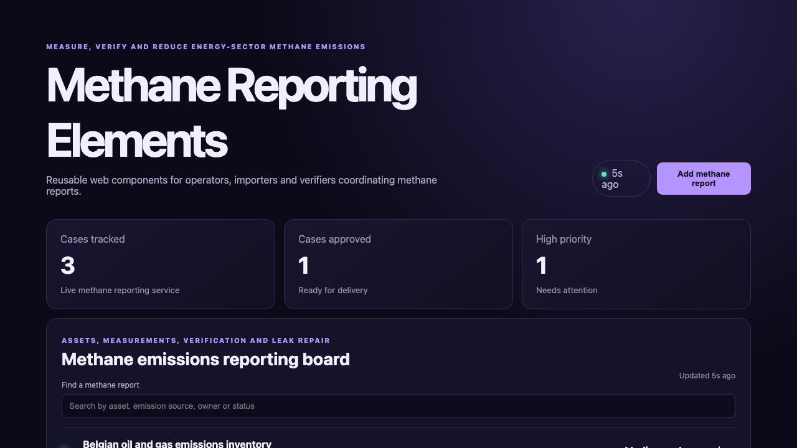

# Methane Reporting Elements

## One-sentence benefit
Helps operators, importers and independent verifiers coordinate methane measurement, verification and leak-repair evidence.

## Live demo
Run the Java service and Lit application locally to use the complete experience.

## Screenshots

## Main features
Search methane reports, create a Belgian leak-survey report, advance readiness and see live priorities through reusable components.

## Technology used
Lit, TypeScript, reactive controllers, web components, Vite, Spring Boot and Java.

## Installation instructions
Start the backend with `cd backend && mvn spring-boot:run`. In another terminal run `npm install && npm run dev`.

## Commercial licensing/contact
Commercial licensing and implementation support are available through the repository owner.

## Business problem and users
Energy operators, importers, competent authorities and verifiers need a shared view of methane measurement gaps and accountable owners.

## Key workflows
Users can filter methane reports, create a verified emission report, progress it and review current priorities.

## Lit and Web Components highlights
The interface uses standards-based custom elements, reactive properties, shadow DOM, a reactive controller and keyed rendering.

## Java backend highlights
The Spring Boot service provides real list, search, create and update endpoints, validation, clear errors, health reporting and tests.

## Architecture and state flow
The main custom element fetches API state, renders reusable status cards and replaces updated records after server writes.

## Accessibility and responsive behaviour
Labelled inputs, semantic headings, text status, visible focus, strong contrast and responsive grids support accessible use.

## Verification commands
Use `npm test`, `npm run build`, and `cd backend && mvn test package`.

## Structure
`src` contains the web components, `backend` contains the Java service, and `docs` contains verified media.

## Tradeoffs
The sample keeps data in memory; production use would add persistent programme data, identity and emissions-measurement integrations.

## Roadmap
Add leak-detection feeds, OGMP evidence, repair timers, importer MRV equivalence and durable audit storage.
